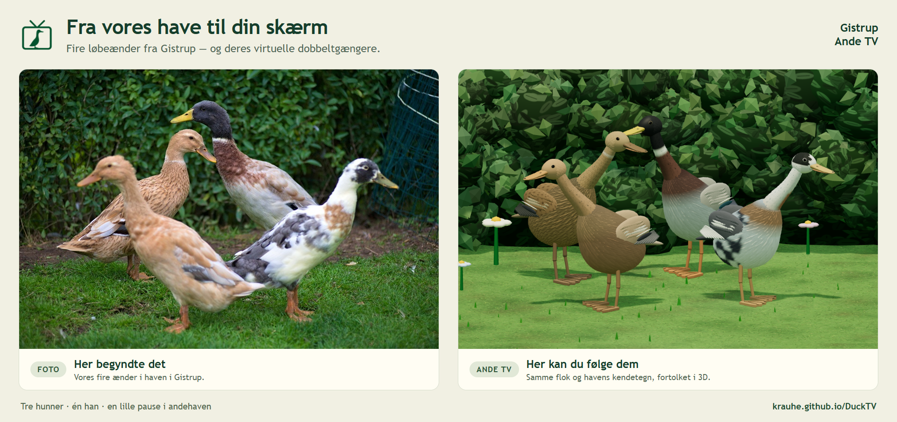

# Gistrup Ande TV

En interaktiv 3D-pauseskærm med vores fire løbeænder: tre hunner og én han. De går rundt i haven, søger føde, bader, pudser fjer og følger hinanden. Udseende og bevægelser er inspireret af fotos og videoer af de rigtige ænder. Vejr og døgnrytme følger Gistrup og kan også indstilles manuelt.

[Åbn Ande TV](https://krauhe.github.io/DuckTV/) · [QR-kode til udskrift](https://krauhe.github.io/DuckTV/ande-tv-qr-print.pdf)

## Fra foto til 3D



Det begyndte med vores egen have og fire løbeænder i Gistrup. Fotoet til venstre er forlægget; til højre er Ande TV's egne 3D-modeller opstillet med tilsvarende placering og retning på græs foran den virtuelle hæk. Den brune hun og hannen står bagest, den lyse og den brogede hun forrest. Farver, aftegninger og havens kendetegn er fortolket i en stiliseret 3D-verden.

Klik på græsset for at kaste pasta. Træk med musen for at dreje kameraet, og brug musehjulet til at zoome. Kameraet kan også følge flokken automatisk.

## Kør lokalt

Kræver Node.js 22.12+ og pnpm.

```sh
pnpm install
pnpm dev
```

Åbn adressen, som terminalen viser, normalt [localhost:5173](http://127.0.0.1:5173/). På Windows kan `Start-Ande-TV.ps1` også starte siden, når pakkerne er installeret.

Bygget med TypeScript, Three.js og Vite. Kør `pnpm test` for tests og `pnpm build` for en produktionsbygning.

Nattehimlen bruger [HYG-stjernekataloget](public/sky-credits.txt) og [Astronomy Engine](https://github.com/cosinekitty/astronomy).

Lydeffekter styres med en slider under Indstillinger. Helt til venstre er lyden slået fra, og lydstyrken huskes. Musik har sin egen kontakt. Regn, blæst og fugle følger vejr og døgn; kontaktlyde, vandplask, vingebask og helikopter følger aktiviteterne. Browseren kræver et tryk eller tastetryk, før lyd kan starte.

To ænder kan svømme efter hinanden i et fælles badeforløb på cirka 24,5 sekunder, afstemt med vand- og andeoptagelsen. Lyden afspilles én gang med blød ind- og udfadning. Bevægelsen fungerer også med lyden slukket, og ænderne reagerer fortsat på forstyrrelser. Originale optagelser i `sound/` og andre private referencer er Git-ignoreret; kun de udvalgte afspilningsklip i `public/audio/effects/` følger projektet.
